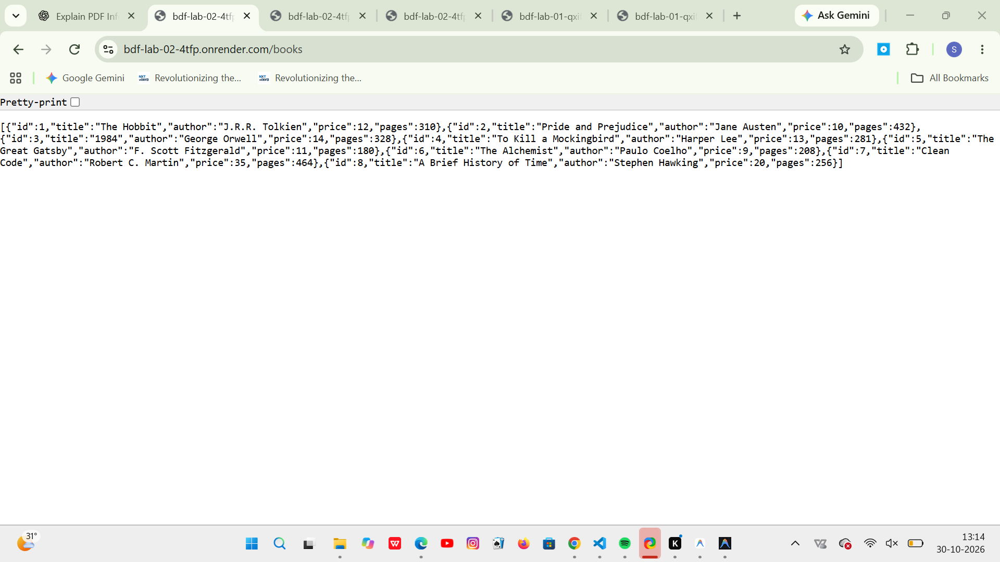
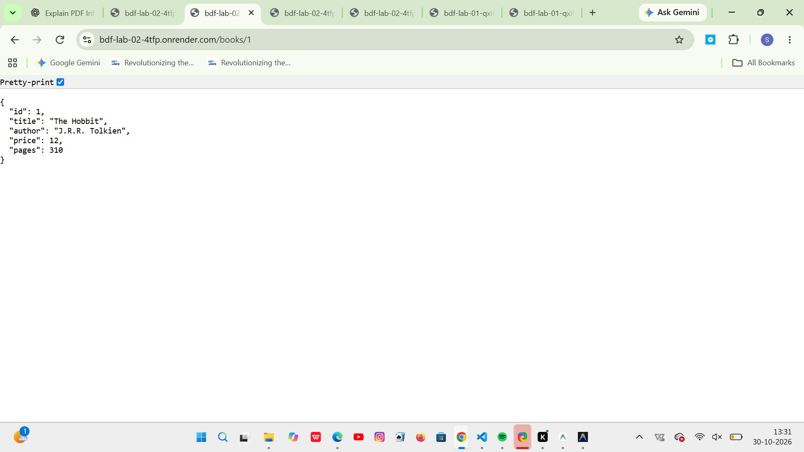
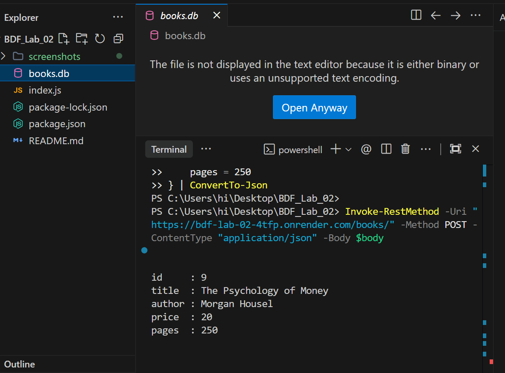
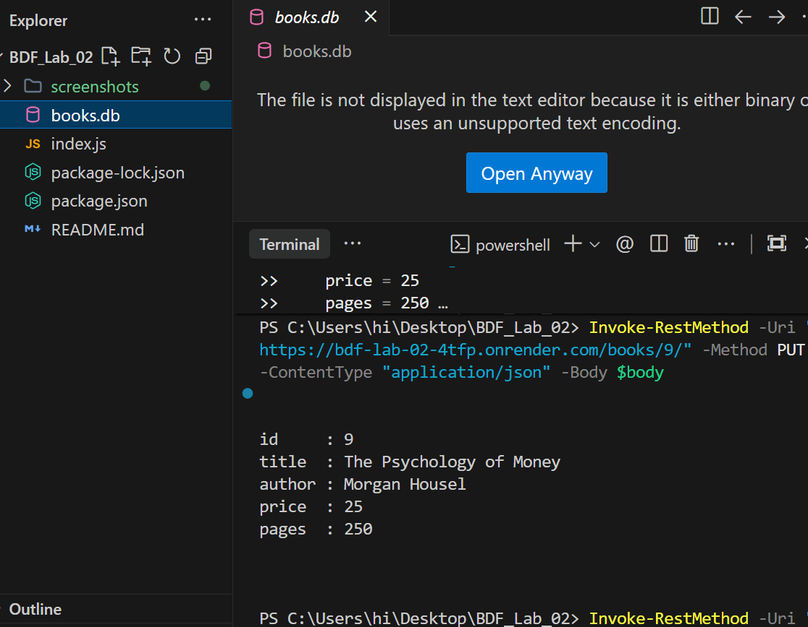
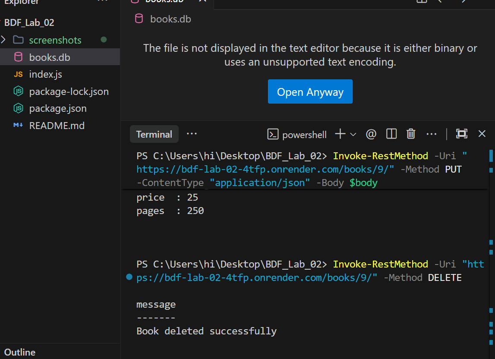
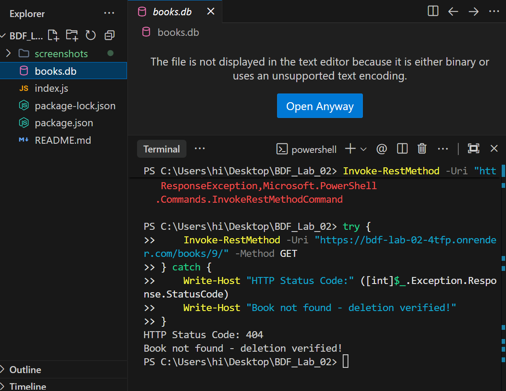
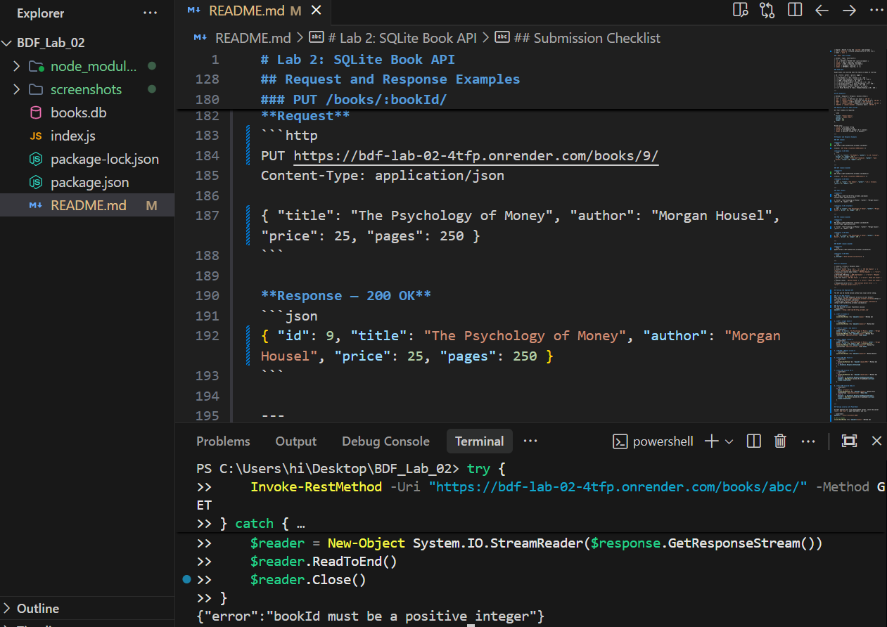
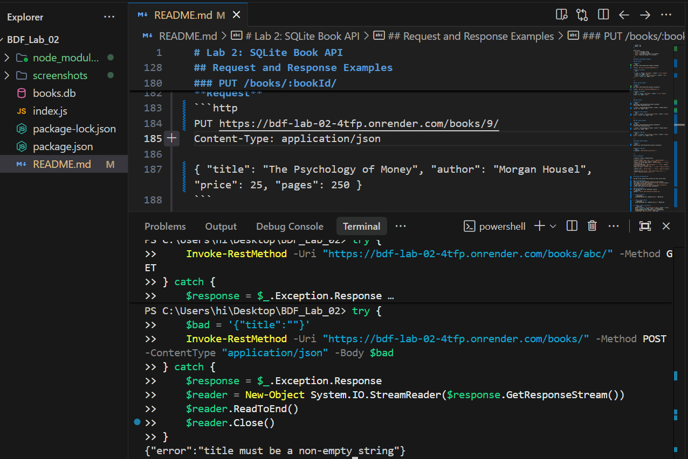
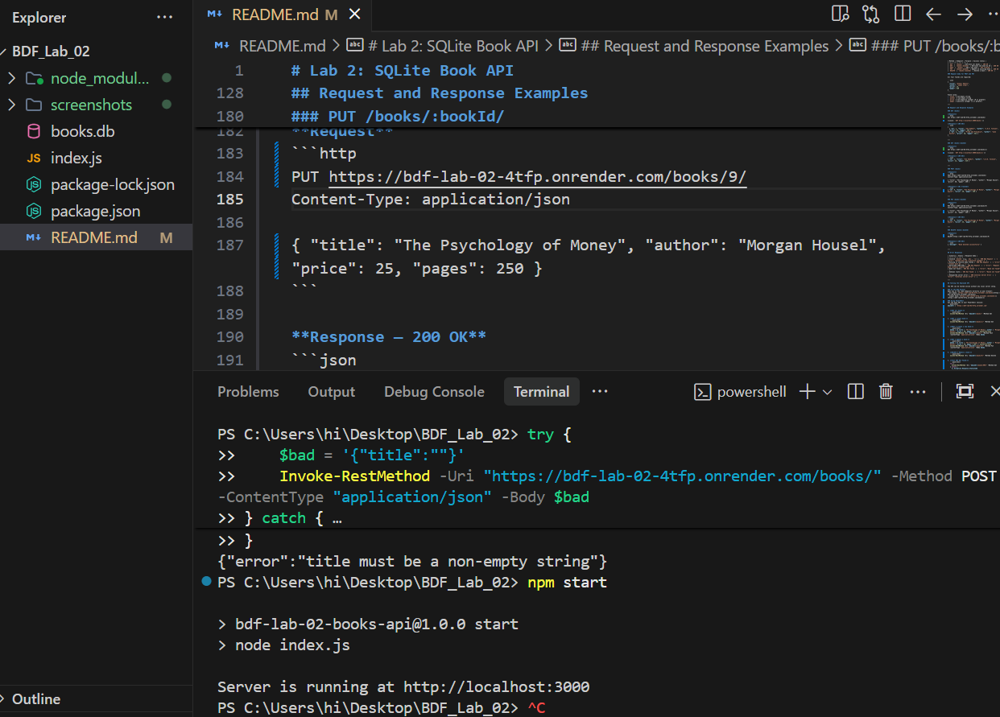
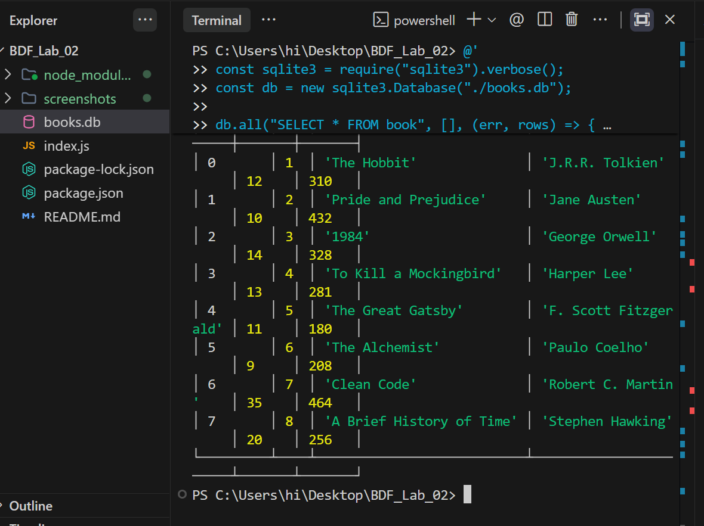

# Lab 2: SQLite Book API

A Node.js and Express REST API for managing books stored in a SQLite database. Demonstrates full CRUD operations, parameterized SQL queries, request validation, and structured error handling.

---

## Live Deployment

The API is deployed and accessible online on **Render**:

- **Render Base URL:** [https://bdf-lab-02-4tfp.onrender.com](https://bdf-lab-02-4tfp.onrender.com)
- **Sample Test Endpoint (GET Book #1):** [https://bdf-lab-02-4tfp.onrender.com/books/1](https://bdf-lab-02-4tfp.onrender.com/books/1)
- **Deployment Status:** Active & Online (note: on Render free instances, the initial request may take a few seconds if the service is spinning up from sleep).

---

## Project Overview

This project implements a RESTful HTTP API with five endpoints that create, read, update, and delete book records. The data is persisted in a local SQLite file (`books.db`). On first startup, the application creates the database file, creates the `book` table, and inserts eight seed records automatically.

---

## Prerequisites

- **Node.js** v18 or later
- **npm** (bundled with Node.js)
- No global SQLite installation required — the `sqlite3` npm package includes the native bindings.

---

## Installation

Open PowerShell inside the project directory and install the dependencies:

```powershell
npm install
```

---

## Starting the Server Locally

```powershell
npm start
```

The server starts on port **3000** by default:

```
Server is running at http://localhost:3000
```

To use a different port, set the `PORT` environment variable before starting:

```powershell
$env:PORT = 4000
npm start
```

---

## Database Details

| Property | Value |
| --- | --- |
| Engine | SQLite 3 (via the `sqlite3` npm package) |
| File | `books.db` (created automatically on first run) |
| Table | `book` |

### `book` table schema

| Column | Type | Constraints |
| --- | --- | --- |
| `id` | INTEGER | PRIMARY KEY (auto-increment) |
| `title` | TEXT | required, non-empty |
| `author` | TEXT | required, non-empty |
| `price` | INTEGER | required, >= 0 |
| `pages` | INTEGER | required, >= 1 |

### Seed data

Eight books are inserted when the table is empty at startup:

| id | title | author | price | pages |
| --- | --- | --- | --- | --- |
| 1 | The Hobbit | J.R.R. Tolkien | 12 | 310 |
| 2 | Pride and Prejudice | Jane Austen | 10 | 432 |
| 3 | 1984 | George Orwell | 14 | 328 |
| 4 | To Kill a Mockingbird | Harper Lee | 13 | 281 |
| 5 | The Great Gatsby | F. Scott Fitzgerald | 11 | 180 |
| 6 | The Alchemist | Paulo Coelho | 9 | 208 |
| 7 | Clean Code | Robert C. Martin | 35 | 464 |
| 8 | A Brief History of Time | Stephen Hawking | 20 | 256 |

---

## API Endpoints

| Method | Endpoint | Purpose | Success status |
| --- | --- | --- | --- |
| `GET` | `/books/` | Retrieve all books | `200 OK` |
| `GET` | `/books/:bookId/` | Retrieve one book by ID | `200 OK` |
| `POST` | `/books/` | Add a new book | `201 Created` |
| `PUT` | `/books/:bookId/` | Update an existing book | `200 OK` |
| `DELETE` | `/books/:bookId/` | Delete a book | `200 OK` |

### Request body for POST and PUT

All four fields are required:

```json
{
  "title": "Atomic Habits",
  "author": "James Clear",
  "price": 15,
  "pages": 320
}
```

Field rules:
- `title` — non-empty string
- `author` — non-empty string
- `price` — non-negative integer (0 or greater)
- `pages` — positive integer (1 or greater)

---

## Request and Response Examples

### GET /books/

**Request**
```http
GET https://bdf-lab-02-4tfp.onrender.com/books/
```
*(Local: `GET http://localhost:3000/books/`)*

**Response — 200 OK**
```json
[
  { "id": 1, "title": "The Hobbit", "author": "J.R.R. Tolkien", "price": 12, "pages": 310 },
  { "id": 2, "title": "Pride and Prejudice", "author": "Jane Austen", "price": 10, "pages": 432 }
]
```

---

### GET /books/:bookId/

**Request**
```http
GET https://bdf-lab-02-4tfp.onrender.com/books/1/
```
*(Local: `GET http://localhost:3000/books/1/`)*

**Response — 200 OK**
```json
{ "id": 1, "title": "The Hobbit", "author": "J.R.R. Tolkien", "price": 12, "pages": 310 }
```

---

### POST /books/

**Request**
```http
POST https://bdf-lab-02-4tfp.onrender.com/books/
Content-Type: application/json

{ "title": "The Psychology of Money", "author": "Morgan Housel", "price": 20, "pages": 250 }
```

**Response — 201 Created**
```json
{ "id": 9, "title": "The Psychology of Money", "author": "Morgan Housel", "price": 20, "pages": 250 }
```

---

### PUT /books/:bookId/

**Request**
```http
PUT https://bdf-lab-02-4tfp.onrender.com/books/9/
Content-Type: application/json

{ "title": "The Psychology of Money", "author": "Morgan Housel", "price": 25, "pages": 250 }
```

**Response — 200 OK**
```json
{ "id": 9, "title": "The Psychology of Money", "author": "Morgan Housel", "price": 25, "pages": 250 }
```

---

### DELETE /books/:bookId/

**Request**
```http
DELETE https://bdf-lab-02-4tfp.onrender.com/books/9/
```

**Response — 200 OK**
```json
{ "message": "Book deleted successfully" }
```

---

## Error Responses

| Scenario | Status | Response body |
| --- | --- | --- |
| Invalid `bookId` (e.g. `abc`, `-1`) | `400 Bad Request` | `{ "error": "bookId must be a positive integer" }` |
| Missing or invalid body fields | `400 Bad Request` | `{ "error": "<field> must be ..." }` |
| Malformed JSON body | `400 Bad Request` | `{ "error": "Request body contains invalid JSON" }` |
| Book not found | `404 Not Found` | `{ "error": "Book not found" }` |
| Unknown route | `404 Not Found` | `{ "error": "Route not found" }` |
| Unexpected server error | `500 Internal Server Error` | `{ "error": "Internal server error" }` |

---

## Testing the Deployed API

The API can be tested online without any local server setup.

### In the Web Browser
Open any of the read endpoints directly in your browser:
- All books: [https://bdf-lab-02-4tfp.onrender.com/books](https://bdf-lab-02-4tfp.onrender.com/books)
- Single book: [https://bdf-lab-02-4tfp.onrender.com/books/1](https://bdf-lab-02-4tfp.onrender.com/books/1)

### Using PowerShell
Set the base URL in your PowerShell session:
```powershell
$baseUrl = 'https://bdf-lab-02-4tfp.onrender.com'
```

1. **GET all books:**
   ```powershell
   Invoke-RestMethod -Uri "$baseUrl/books/" -Method Get
   ```

2. **GET a single book:**
   ```powershell
   Invoke-RestMethod -Uri "$baseUrl/books/1/" -Method Get
   ```

3. **POST — Create a new book:**
   ```powershell
   $body = @{ title = 'The Psychology of Money'; author = 'Morgan Housel'; price = 20; pages = 250 } | ConvertTo-Json
   Invoke-RestMethod -Uri "$baseUrl/books/" -Method Post -ContentType 'application/json' -Body $body
   ```

4. **PUT — Update a book:**
   ```powershell
   $body = @{ title = 'The Psychology of Money'; author = 'Morgan Housel'; price = 25; pages = 250 } | ConvertTo-Json
   Invoke-RestMethod -Uri "$baseUrl/books/9/" -Method Put -ContentType 'application/json' -Body $body
   ```

5. **DELETE — Remove a book:**
   ```powershell
   Invoke-RestMethod -Uri "$baseUrl/books/9/" -Method Delete
   ```

6. **Test 404 Not Found:**
   ```powershell
   try {
     Invoke-RestMethod -Uri "$baseUrl/books/999/" -Method Get
   } catch {
     $_.Exception.Response.StatusCode
   }
   ```

7. **Test 400 Invalid ID:**
   ```powershell
   try {
     Invoke-RestMethod -Uri "$baseUrl/books/abc/" -Method Get
   } catch {
     $stream = $_.Exception.Response.GetResponseStream()
     $reader = New-Object System.IO.StreamReader($stream)
     $reader.ReadToEnd()
   }
   ```

8. **Test 400 Invalid Body:**
   ```powershell
   try {
     $bad = '{"title":""}'
     Invoke-RestMethod -Uri "$baseUrl/books/" -Method Post -ContentType 'application/json' -Body $bad
   } catch {
     $stream = $_.Exception.Response.GetResponseStream()
     $reader = New-Object System.IO.StreamReader($stream)
     $reader.ReadToEnd()
   }
   ```

---

## Testing Locally with PowerShell

To test against your local development server, start the server first (`npm start`), open PowerShell, and run:

```powershell
$baseUrl = 'http://localhost:3000'

# GET all books
Invoke-RestMethod -Uri "$baseUrl/books/" -Method Get

# GET one book
Invoke-RestMethod -Uri "$baseUrl/books/1/" -Method Get

# POST — create a book
$body = @{ title = 'Atomic Habits'; author = 'James Clear'; price = 15; pages = 320 } | ConvertTo-Json
Invoke-RestMethod -Uri "$baseUrl/books/" -Method Post -ContentType 'application/json' -Body $body

# PUT — update a book
$body = @{ title = 'Atomic Habits'; author = 'James Clear'; price = 16; pages = 320 } | ConvertTo-Json
Invoke-RestMethod -Uri "$baseUrl/books/9/" -Method Put -ContentType 'application/json' -Body $body

# DELETE — delete a book
Invoke-RestMethod -Uri "$baseUrl/books/9/" -Method Delete
```

---

## Screenshots

The following screenshots document the functionality of the API:

### 1. GET All Books


### 2. GET One Book by ID


### 3. POST Create Book


### 4. PUT Update Book


### 5. DELETE Book


### 6. Error 404 Not Found


### 7. Error 400 Invalid ID


### 8. Error 400 Invalid Body


### 9. Server Startup


### 10. Database Table & Records


---

## Submission Checklist

- [x] `01_get_all_books.png` — Browser/PowerShell output of `GET /books/`
- [x] `02_get_one_book.png` — Browser/PowerShell output of `GET /books/1/`
- [x] `03_post_create_book.png` — PowerShell output of `POST /books/`
- [x] `04_put_update_book.png` — PowerShell output of `PUT /books/:id/`
- [x] `05_delete_book.png` — PowerShell output of `DELETE /books/:id/`
- [x] `06_error_404_not_found.png` — Error response for non-existent book (404)
- [x] `07_error_400_invalid_id.png` — Error response for invalid ID (400)
- [x] `08_error_400_invalid_body.png` — Error response for invalid body (400)
- [x] `09_server_startup.png` — Terminal showing `Server is running at http://localhost:3000`
- [x] `10_database_table.png` — Query output displaying `book` table schema and seed rows
